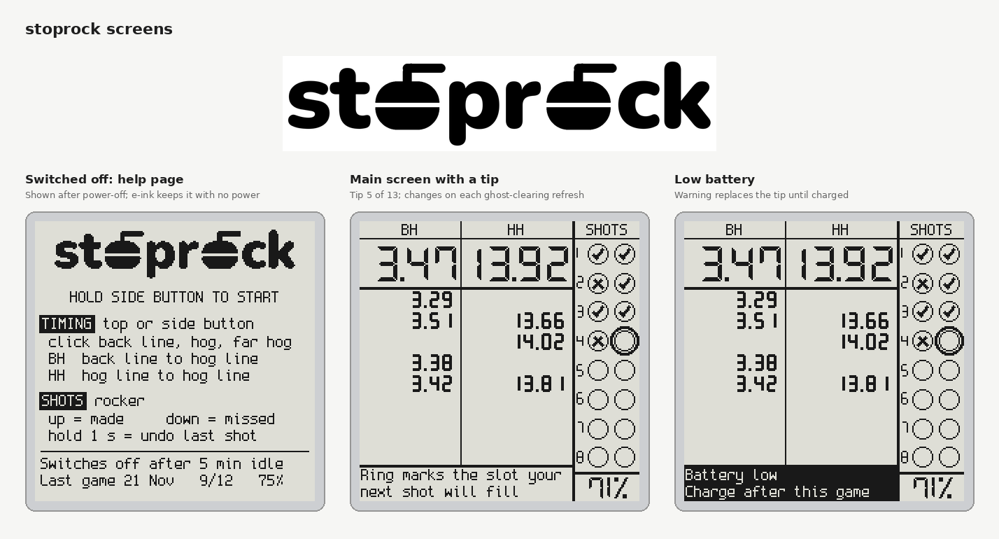

# stoprock

A pocket curling stopwatch and shot-percentage tracker.

- **Timing:** click at the back line, near hog and far hog. The stoprock works out back-line-to-hog (BH) and hog-to-hog (HH) times from the gaps and shows the newest result large, in a fixed spot, as fast as the e-ink screen allows.
- **Shots:** rocker up for a made shot, down for a miss, hold to undo. Tracks your percentage for the game and over the season.



## Status

Design agreed; firmware not started. Prototype hardware is an M5Stack CoreInk (ESP32, 1.54" 200 × 200 e-ink), with a custom enclosure planned.

## Contents

| Path | What |
|---|---|
| [`docs/SPEC.md`](docs/SPEC.md) | Device specification: controls, timing rules, screens, power, screen-update plan, open items |
| [`docs/mockups/`](docs/mockups/) | Pixel-exact screen mockups; `explorations/` holds the font and logo comparisons that led to them |
| [`assets/logo/`](assets/logo/) | Wordmark: full resolution and the 176 px 1-bit version for the screen |
| [`assets/fonts/`](assets/fonts/) | DSEG7 Classic Bold, Spleen 6×12 and Nunito, each with its licence |
| [`tools/mockups/`](tools/mockups/) | Python scripts that draw the mockups and logo |

## Regenerating the mockups

Requires Python 3 and Pillow.

```sh
pip install pillow
python tools/mockups/render.py
```

## Font licences

DSEG7 and Nunito: SIL Open Font License 1.1. Spleen: BSD 2-clause. See `assets/fonts/`.
