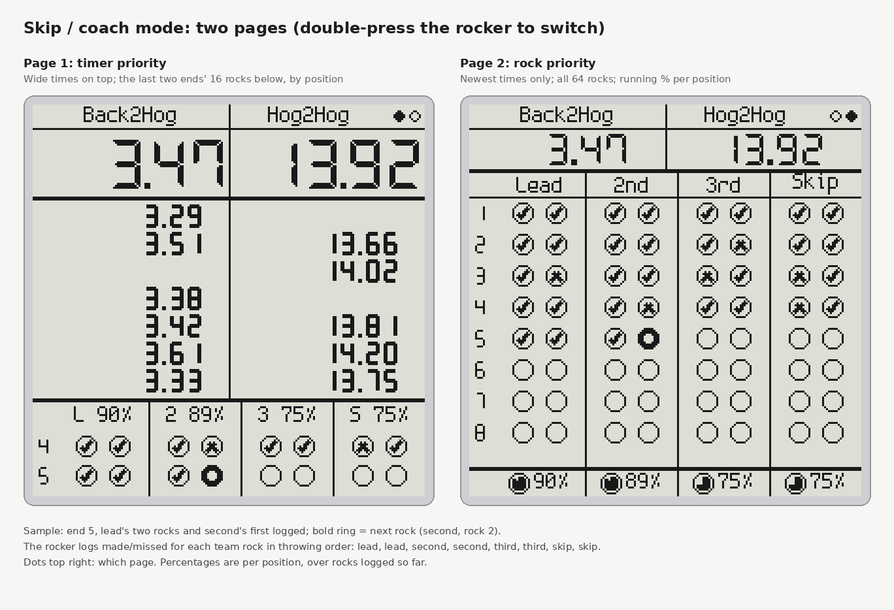

# Pro mode (planned, not built)

Features for a paid tier, unlocked by the companion app. Nothing here is implemented yet; this records the
design so far.

## Unlocking

The paid app unlocks pro mode over Bluetooth. Suggested approach: the app sends a licence signed with the
publisher's private key and tied to the device's unique ID; the firmware checks the signature with a public key
built into it and stores the licence in flash. No network is needed on the device, and a licence can't be copied
to another device.

## Skip / coach mode

Tracks a whole team instead of one player. Two pages; **double-press the rocker's centre** to switch (a single
press of the centre does nothing today, so it doesn't clash with hold-to-undo). Two dots top right show which
page is up.

**Page 1, timer priority.** Times across the full width (Back2Hog and Hog2Hog 100 px each), newest large with the
previous 7 below. Along the bottom, the previous and current end's 16 rocks in four columns (lead, second, third,
skip), each headed with that position's running percentage.

**Page 2, rock priority.** Only the newest times, smaller. All 64 rocks: 8 ends by four positions, two rocks
each. Along the bottom, each position's running percentage with a small pie.

**Logging.** The rocker logs made/missed in throwing order (lead, lead, second, second, third, third, skip,
skip), with the same bold-ring cursor and hold-to-undo as player mode.

**Open decisions**
1. How coach mode is entered (once unlocked): a setting, or holding the rocker while switching on.
2. Page 1 shows 7 earlier stones; two pairs to a row would show about 14, at some cost to readability.
3. The databank stores 16 rocks for one player per game. Coach mode needs 64 across four positions: record
   format version 3. The app protocol stays the same.
4. Times stay separate from positions, since coaches usually time both teams' stones.
5. At the smaller rock size the ✗ is a 4 px cross; if it doesn't read on the real screen, a filled dot for
   missed would contrast better.

The mockup is drawn by [`tools/mockups/coach_mode.py`](../tools/mockups/coach_mode.py).
