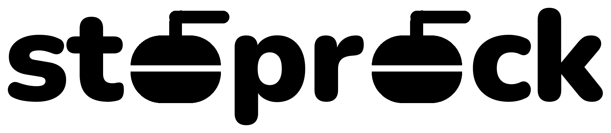

# stoprock style guide

How stoprock looks and speaks: on the device, in the tutorials, and in the docs. Follow it in new
screens, cards and text; when something here disagrees with older text, this wins.

## Name and logo

- The name is **stoprock**, all lowercase, also at the start of a sentence.
- The wordmark is drawn in Nunito Black, both o's as curling rocks:
  - [`assets/logo/stoprock-logo.png`](../assets/logo/stoprock-logo.png): full resolution, for print and the web.
  - [`assets/logo/stoprock-logo-176px-1bit.png`](../assets/logo/stoprock-logo-176px-1bit.png): 176 px wide,
    1 bit, as the device shows it (the startup menu and the off page).
  - The off page: [`assets/screens/wake-screen-200x200-1bit.png`](../assets/screens/wake-screen-200x200-1bit.png).
- Both are drawn by [`tools/mockups/logo.py`](../tools/mockups/logo.py); regenerate them rather than editing the
  images. Don't stretch, recolour or outline the wordmark; on black it's drawn white (competition's badge strip).

## Numbers and units

- Seconds: no space between the number and the unit: **7s**, **0.2s**, **3s**, not "7 s". The same in tables,
  code comments and tooltips. On the device, where there's room, spell it out ("Hold the side button 3 seconds").
- Times are given to the hundredth, as the device shows them: **3.41**, **13.86**.
- Write numbers as digits on the device and in tables ("2x", "4 rows"); in prose, words for one to nine are fine.

## Words

The same word for the same thing, everywhere: on the device, in the tutorials, in the docs.

| Use | Not |
|---|---|
| press (a short press) | tap, click (except "double-click") |
| hold (a long press; say how long: "hold 3s") | long-press |
| double-click | double-tap, double press |
| the top button, the side button: the **timing buttons** | timer button, stopwatch button |
| the rocker: up, the middle, down | the centre, the dial |
| B2H (back line, or tee line, to hog), H2H (hog to hog) | split, Back2Hog in running text |
| time (a measured B2H or H2H) | split, reading, entry |
| shot, rock (a logged made or missed) | entry |
| made, missed | hit, miss |
| THEM (the other team's column) | Opp, opponent |

- Spelling is Canadian English: centre, colour.
- Short sentences. On the device, a tooltip or tutorial line says one thing.

## On the screen

- 200 x 200, 1 bit. Black ink on white, white on black for emphasis; nothing in between.
- **B2H black on white, on the left; H2H white on black, on the right** — in the big numbers, the columns and
  every illustration. There are no B2H/H2H labels on the timing screens: the colours are the label.
- A made rock is a filled disc, a missed rock a ring with a dot, a rock not yet thrown an empty ring; the next
  rock to log has a bold ring.
- The highlighted (inverted) header is the player the next time goes to.
- The player columns (competition, league, coach) run in throw order with THEM in the middle: the teammate before, THEM, the teammate whose pair is under way or next. Their headers are all alike, bold Spleen 12x24.
- Typefaces:
  - **DSEG7 Classic Bold**: the big times.
  - Drawn seven-segment digits: the times in the columns.
  - **Nunito** (ExtraBold, Bold): the startup menu, tutorials and tips.
  - **Spleen 6x12**: small labels (headers, the badge strip).

## Tutorial cards

Drawn by [`tools/tutorials_claude/build.py`](../tools/tutorials_claude/build.py) and stored in the firmware by
[`tools/tutorials.py`](../tools/tutorials.py).

- One idea a card, a short title, at most **two lines** of copy (Nunito Bold 15), each checked to fit.
- Draw things as the screen draws them (colours, rocks, highlight), and the device as it is
  ([`hardware/coreink/coreink.json`](../hardware/coreink/coreink.json)): buttons where they really are.
- Arrows are smooth curves with solid heads, drawn at 4x and reduced to 1 bit; text is drawn at 1x, crisp.
- Order: timing first, then reading the screen and the rocker, then power.
