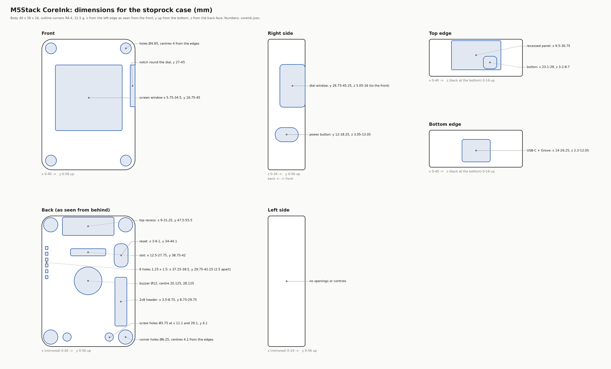

# M5Stack CoreInk: dimensions

Our record of the CoreInk's outside dimensions and the openings in its enclosure: everything the
stoprock case depends on. Measured for this project, in millimetres. The same numbers, machine
readable, are in [`coreink.json`](coreink.json), which the case model
([`../case/case.py`](../case/case.py)) reads. [`coreink-dimensions.png`](coreink-dimensions.png) is
drawn from that file by [`drawing.py`](drawing.py).

## How to read the numbers

Hold the CoreInk with the screen towards you and the USB-C port at the bottom.

- **x**: from the left edge (0) to the right edge (40).
- **y**: from the bottom (0) to the top (56).
- **z**: from the back face (0) to the front face (16).

Features on the back use the same x as seen from the front. Seen from behind, left and right swap:
a feature at x = 6 is 6 mm from the *right* edge when you look at the back.

## Body

| | |
|---|---|
| Size | 40 wide x 56 tall x 16 deep |
| Outline corners (seen from the front) | R 4.4 |
| Edges of the front and back faces | rounded, about R 0.3 |
| Enclosure walls | about 0.9-1.7 thick |
| Weight | 31.5 g (M5Stack), 390 mAh battery inside |

## Front

| Feature | x | y | Notes |
|---|---|---|---|
| Screen window | 5.75-34.5 | 16.75-45.0 | 28.75 x 28.25, centre (20.1, 30.9), 25.1 below the top. Visible display area 27.6 x 27.6 |
| Holes (4) | centres 4 and 36 | centres 4 and 52 | Ø 4.85 (M5Stack's drawing) |
| Notch round the dial | 37.75-40 | 27-45 | the front shell is cut back at the right edge |

## Top edge

| Feature | x | z | Notes |
|---|---|---|---|
| Recessed panel | 9.5-30.75 | 2.8-15.4 | set slightly below the top face |
| **Top button** | 23.1-29.0 | 3.2-8.7 | centre x 26.05, z 5.95 (nearer the back); its key is flush with the top face. M5Stack's drawing: 7.4 wide including its surround, 22.3-29.7 from the left |

On the back face, behind the panel, there is a recess at x 9-31.25, y 47.5-55.5.

## Right side

| Feature | y | z | Notes |
|---|---|---|---|
| **Dial window** (3-way: up / press / down) | 26.75-45.25 | 5.05-16.0 | 18.5 long, centre y 36 (20 below the top); runs through to the front face |
| **Power button** | 12.0-18.25 | 3.05-13.05 | oval, 6.25 tall x 10 front-to-back; centre y 15.1 (15 above the bottom), z 8.05 |

## Left side

No openings or controls.

## Bottom edge

| Feature | x | z | Notes |
|---|---|---|---|
| **Port opening** (USB-C and Grove) | 14.0-26.25 | 2.3-12.05 | 12.25 x 9.75, centre x 20.1, z 7.2 |

## Back

x as seen from the front (from behind, measure from the other edge).

| Feature | x | y | Notes |
|---|---|---|---|
| **Reset button** | 3.0-9.1 | 34.0-44.1 | oval, centre (6.05, 39.05): 17 below the top |
| Expansion header window | 3.5-8.75 | 8.75-29.75 | 2 x 8 pins, 2.54 pitch |
| Buzzer grille | centre 20.1 | centre 28.1 | Ø 12, centre hole Ø 2 |
| Slot | 12.5-27.75 | 38.75-42.0 | |
| Small holes (6) | 37.25-38.5 | centres 29.75-42.25, 2.5 apart | each 1.25 x 1.5 |
| Screw holes (2) | centres 11.1 and 29.1 | centre 4.1 | Ø 3.75 |
| Corner holes (4) | centres 4.1 and 36.1 | centres 4.1 and 52.1 | Ø 6.25 |

## Not recorded here

- How far the dial wheel and the buttons stand out from the enclosure, and the dial's own size
  inside its window: these are parts of the mechanism, not the enclosure. The case is designed
  around the openings above, which is all it needs.
- The seam between the front and back shells.

Corrections from a check on a real device are welcome: change `coreink.json`, then rerun
`python hardware/coreink/drawing.py` and `python hardware/case/case.py`.
